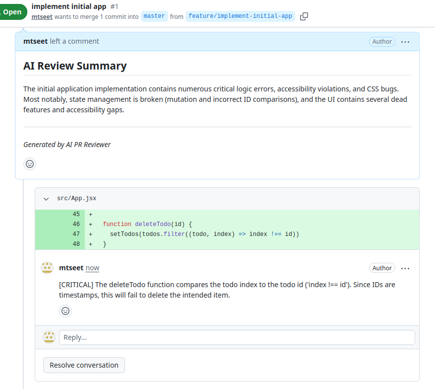
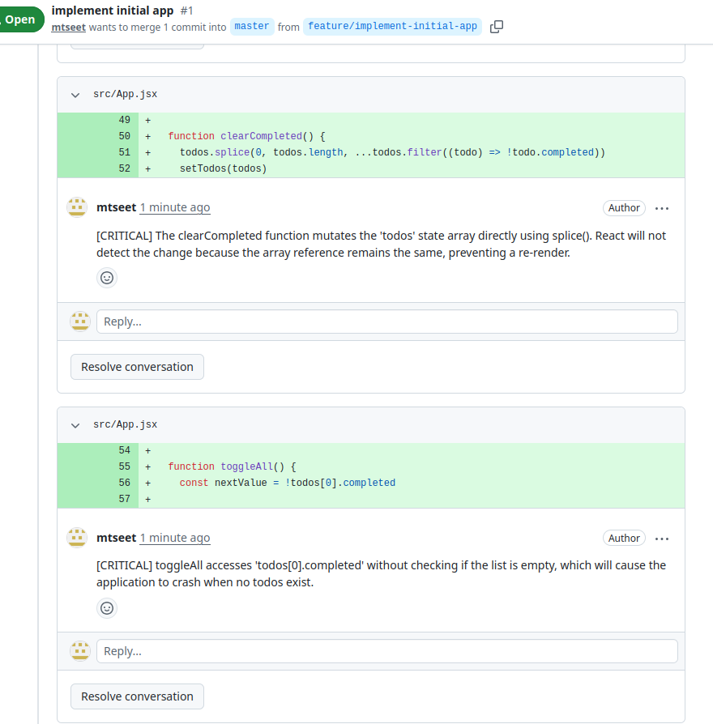
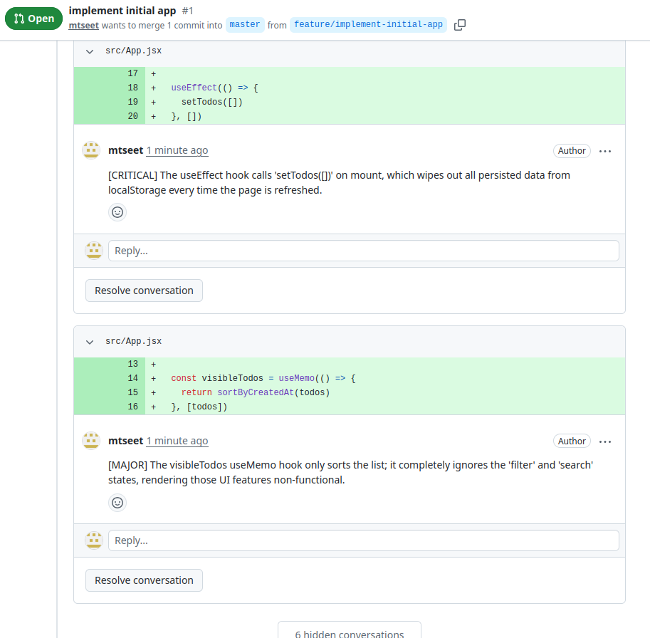
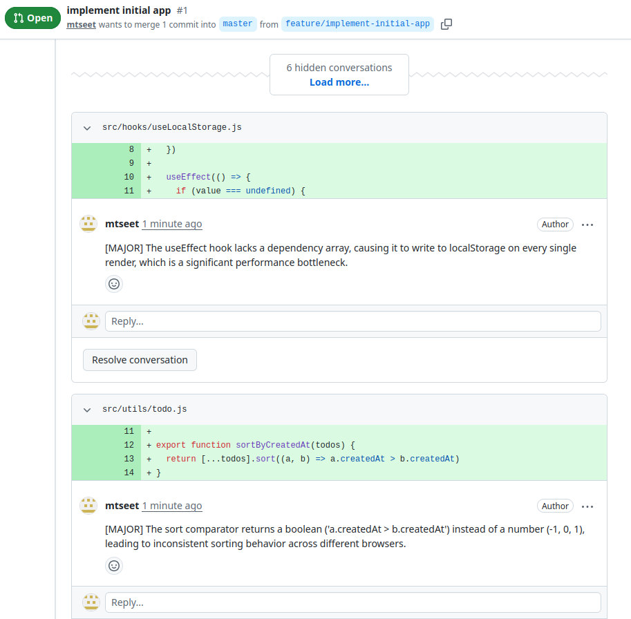
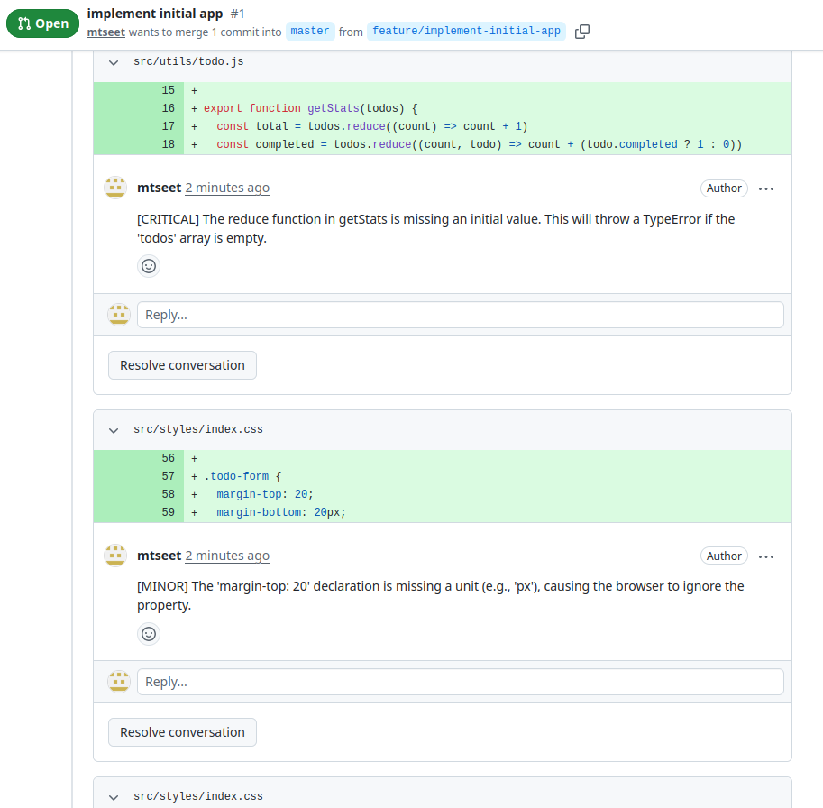
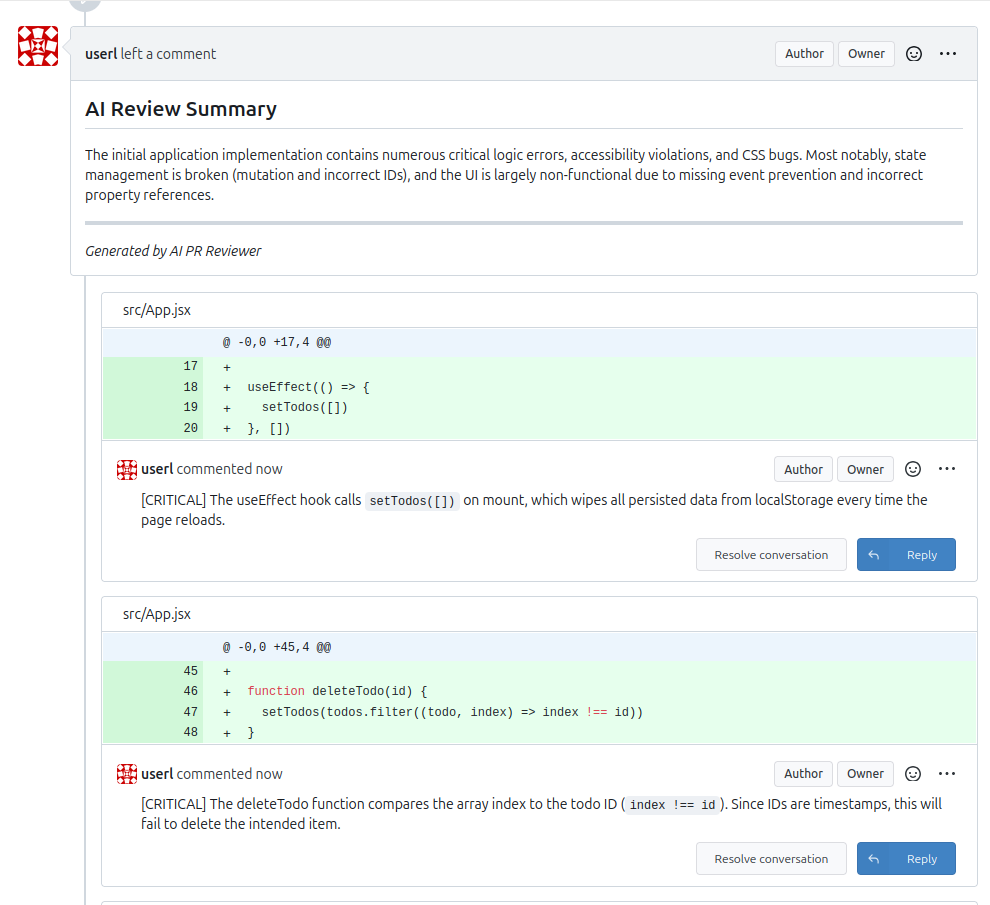

# pr-reviewer-agent
pr-reviewer-agent - An AI agent for reviewing prs

## Description
An AI Agent that reviews prs

### Features
- gitea support
- github support

## Screenshot
<div style="display: flex; gap: 10px;">



</div>

<div style="display: flex; gap: 10px;">



</div>

<div style="display: flex; gap: 10px;">



</div>

## Binary

Check on releases page.

## Configuration

`cp .env.example .env`

Then update the variables in .env

```
OPENAI_API_KEY=secret
OPENAI_API_BASE_URL=http://localhost:8080/v1
OPENAI_MODEL=your model

GITEA_OWNER=someowner
GITEA_TOKEN=secret_token
GITEA_BASE_URL=http://localhost:3000

GITHUB_TOKEN=ghp_your-token-here   
```

## Installation and Build Instractions

```
curl --proto '=https' --tlsv1.2 -sSf https://sh.rustup.rs | sh

cargo build
cargo run
```

## Usage Instructions
```
pr-reviewer-agent --help
AI-based PR reviewer for Gitea/GitHub

Usage: pr-reviewer-agent --repotype <REPOTYPE> --repo <REPO> --prid <PRID>

Options:
      --repotype <REPOTYPE>  Repository type (gitea, github)
      --repo <REPO>          Repository name (or owner/repo)
      --prid <PRID>          Pull request ID
  -h, --help                 Print help
  -V, --version              Print version
```

## Support
You can buy me a coffee if you like this software

<a href="https://www.buymeacoffee.com/mtseet" target="_blank"></a>